# Menú de plantillas largas

Cada plantilla es una forma completa de editar un video largo: cómo se ve, qué va en cada parte y qué material hace falta.
Para verlo con imágenes y clips en tu computadora, abre `menu/index.html` (o pídele a Claude: «enséñame el menú de plantillas»).

| # | Plantilla | Qué es | Duración ideal |
|---|---|---|---|
| 1 | **Neón** | Video de venta horizontal con gráficos y cifras animadas sobre fondo oscuro de luces naranja y azul, capturas de prueba y recorrido de la plataforma con la persona en una ventanita. | de 3 a 10 minutos |
| 2 | **Cinético** | Video de venta horizontal de una persona a cámara, con palabras gigantes que pasan detrás de su cabeza, frases al pecho, insertos sobre negro y una barra roja de avance. | de 5 a 10 minutos |
| 3 | **Testimonios** | Compilado horizontal de testimonios a corte seco: las fuentes se ven tal como vienen, con tomas de evento encima de las voces y subtítulo amarillo solo en la frase clave. | de 3 a 6 minutos |

## Plantilla larga 1 · Neón

Video de venta horizontal con gráficos y cifras animadas sobre fondo oscuro de luces naranja y azul, capturas de prueba y recorrido de la plataforma con la persona en una ventanita.

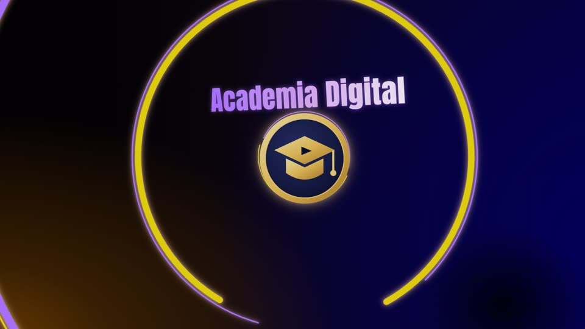 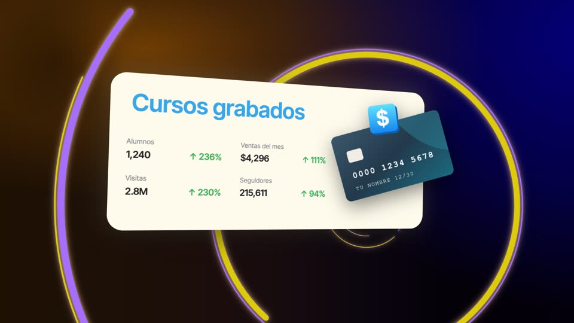 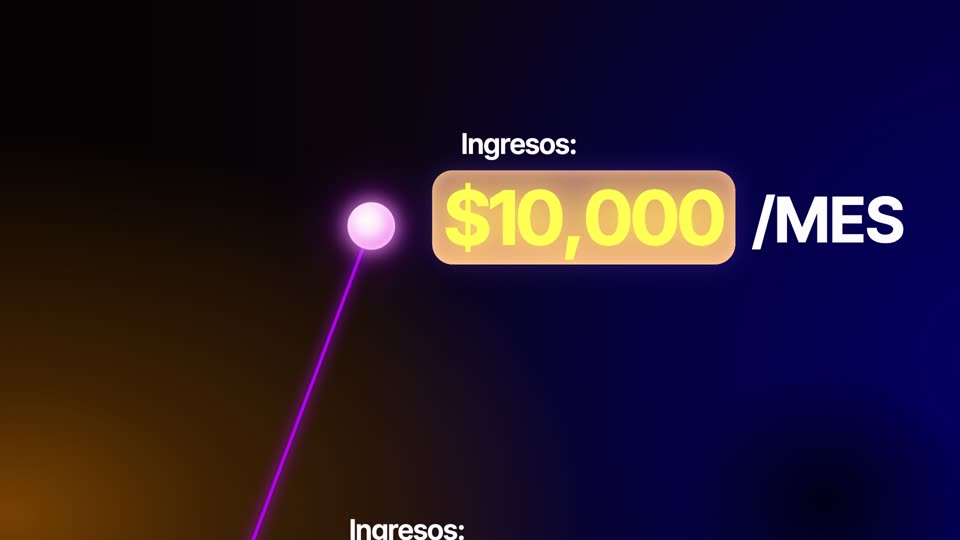 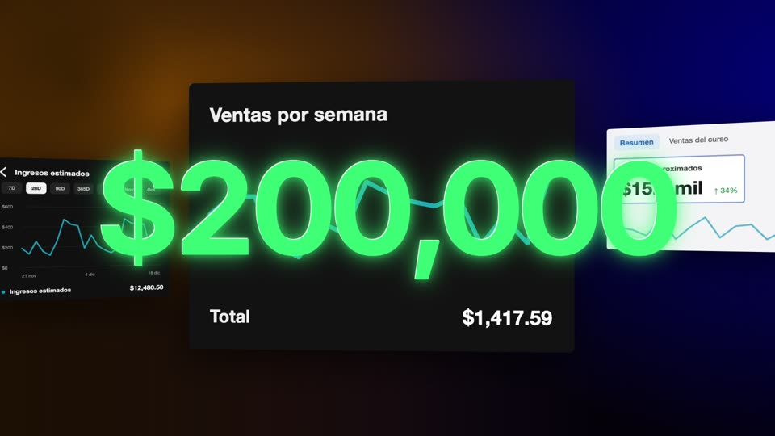 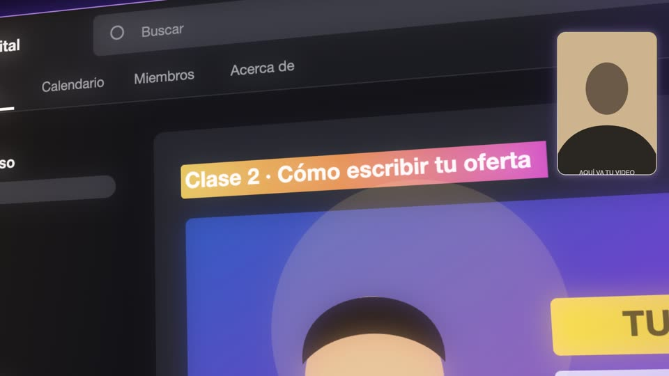 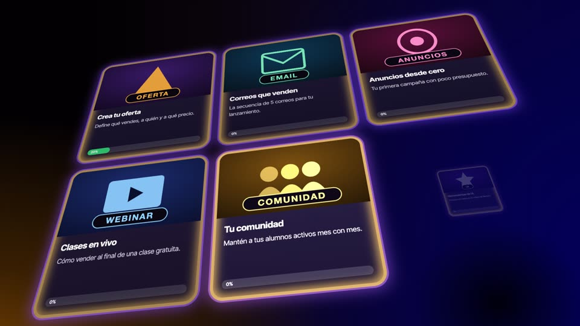 

**Para usarla, dile a Claude:** «Edita este video con la plantilla Neón: /ruta/a/mi-video.mp4»

**Sirve para:** Video de venta de una comunidad, curso o membresía; Recorrido de un producto digital por dentro, de 2 a 4 minutos; Presentar resultados con cifras y capturas reales; Lanzamiento con precio de hoy y precio de después.

**Mejor usa otra si:** Video a cámara sin plataforma ni capturas que enseñar: usa la plantilla Cinético; Compilado de testimonios de clientes: usa la plantilla Testimonios; Clases o cursos de 30 minutos o más: usa editor-cursos.

**Lo que necesitas tener:**
- 1 video a cámara, horizontal, grabado con el guion-molde
- 1 grabación de pantalla de la plataforma, de 1.5 a 2 minutos, en tema oscuro
- 6 a 10 capturas reales de resultados, con la cifra que se marca en cada una
- 1 logo redondo con fondo transparente
- 3 a 5 portadas verticales y 8 miniaturas horizontales de su trabajo
- Cifras reales: 2 pilares con sus datos, 2 metas, años de trayectoria, cifra mensual y cifra más grande
- 3 tomas de apoyo distintas del negocio (video o foto)
- 6 o más portadas de lo que incluye, con título y una línea
- La oferta: precio de hoy, precio de después, enlace, texto del botón y garantía
- 1 canción con licencia

**Tiempo de edición:** 2 a 3 horas por cada 3 minutos de video, con el material completo (estimado)

**Cómo se reparte el video:**

| Parte | % | Qué pasa |
|---|---|---|
| Gancho | 5 | La pregunta del espectador en una barra de búsqueda, su dolor en una cifra y el logo del producto. |
| Promesa | 5 | Dos tarjetas con los pilares del producto y una gráfica con las metas de dinero. |
| Autoridad y prueba | 6 | Años de trayectoria, capturas reales con la cifra marcada en verde y un contador gigante. |
| Puente | 4 | La pantalla del producto inclinada en 3D y la persona anuncia que lo va a enseñar por dentro. |
| Recorrido | 48 | La grabación de pantalla ocupa el cuadro y la persona queda en una ventanita arriba a la derecha. |
| Niveles | 4 | Escalones que muestran las etapas, con una bolita que salta de una a otra. |
| Respaldo | 9 | Tres tomas del negocio real con rótulo, una cifra con su medio y la rejilla de todo lo que incluye. |
| Oferta | 7 | La persona dice el precio y una tarjeta de inscripción muestra cómo sube después. |
| Llamado a la acción | 12 | La persona a cámara con un botón que recibe el clic, la garantía y la despedida. |

**Archivos:** `plantillas/neon/ESTILO.md` (cómo se ve y cómo usarla), `ESCALETA-BASE.md` (estructura y guion para grabar), `base/` (proyecto en blanco).
Empezar un video: `scripts/nuevo.sh neon "Nombre del video" /ruta/al/video-cortado.mp4`

## Plantilla larga 2 · Cinético

Video de venta horizontal de una persona a cámara, con palabras gigantes que pasan detrás de su cabeza, frases al pecho, insertos sobre negro y una barra roja de avance.

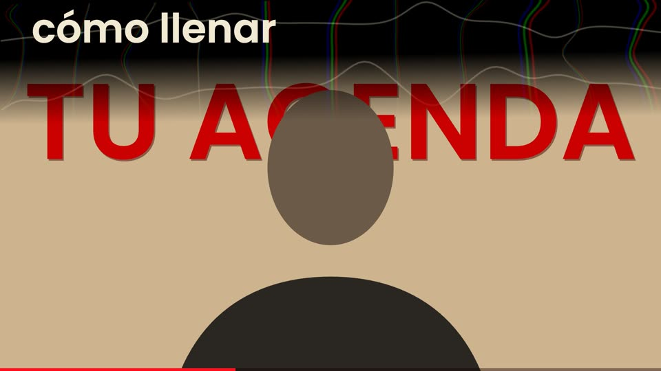 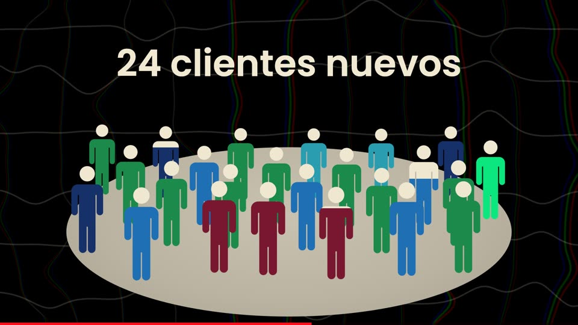 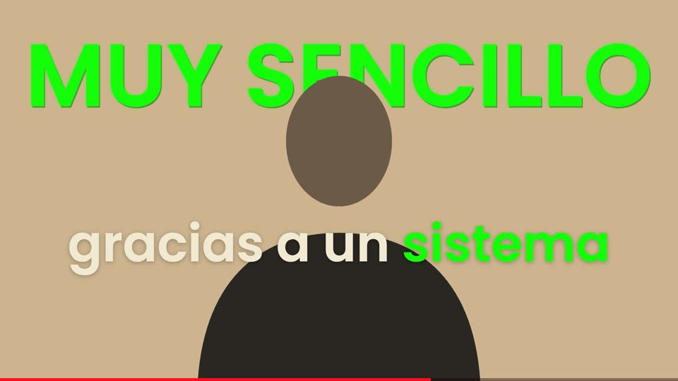 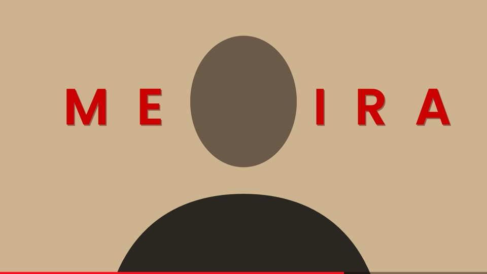 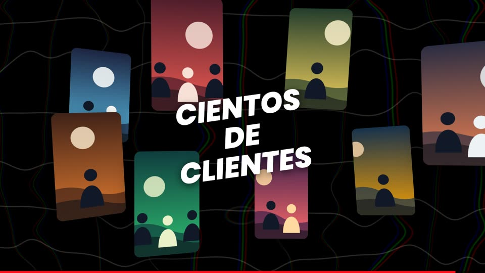 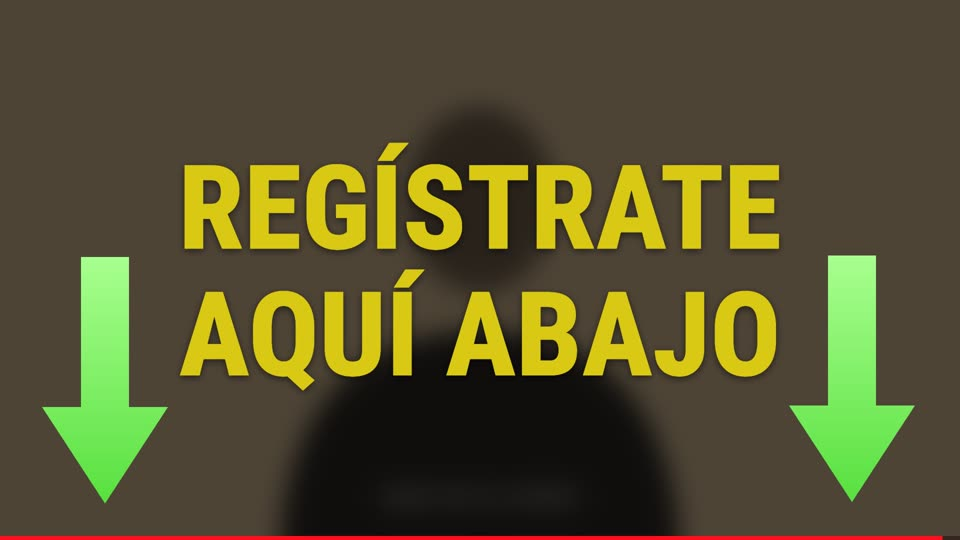 

**Para usarla, dile a Claude:** «Edita este video con la plantilla Cinético: /ruta/a/mi-video.mp4»

**Sirve para:** Video de venta de un experto a cámara, sin plataforma que enseñar; Presentar un método o sistema en pasos; Invitar a un evento, clase gratuita o llamada; Video de marca personal con mucho énfasis en las palabras.

**Mejor usa otra si:** Enseñar una plataforma por dentro con grabación de pantalla: usa la plantilla Neón; Compilado de testimonios de clientes: usa la plantilla Testimonios; Videos grabados con fondo recargado o con la persona moviéndose: el texto detrás no se lee.

**Lo que necesitas tener:**
- 1 video a cámara, horizontal, sobre fondo liso, grabado con el guion-molde
- Nombre de la persona y de 2 a 4 credenciales cortas
- 1 logo del programa con fondo transparente
- 25 a 30 tomas de apoyo distintas por cada 3 minutos (salen de 4 a 6 videos de eventos, oficina o clientes)
- 8 o más fotos de clientes o eventos, y 3 más para las fotos apiladas
- 1 a 2 capturas o grabaciones de pantalla
- 3 cifras reales: la de la promesa, a cuántos ha ayudado y en cuántos lugares
- Los 3 pasos del sistema, con nombre de 1 a 3 palabras
- 1 caso de éxito con nombre, foto o video y resultado
- El llamado a la acción exacto y 1 canción con licencia

**Tiempo de edición:** 3 a 4 horas por cada 3 minutos de video, con el material completo (estimado)

**Cómo se reparte el video:**

| Parte | % | Qué pasa |
|---|---|---|
| Gancho y promesa | 4 | Promesa con cifra: reloj detrás, cortina con título, multitud y remate en escalera. |
| Presentación y autoridad | 7 | Nombre de la persona, credenciales en rótulos amarillos sobre tomas de apoyo y fotos de clientes. |
| Dolor y creencia falsa | 12 | Negación en letras separadas, lista de dolores a un lado de la cara y sello NO. |
| Giro y solución | 15 | Palabras gigantes encadenadas, el logo del programa, el signo igual y una captura. |
| El sistema en 3 pasos | 23 | Cada paso con su nombre a un lado de la cara, una toma de apoyo y un inserto con íconos o figuras. |
| Propósito | 12 | Más persona a cámara, con frases al pecho y una ráfaga de tomas de apoyo. |
| Caso de éxito | 7 | Tomas del cliente con su nombre, la captura de su resultado y una pared de fotos. |
| Qué es y qué no es | 8 | Frases tachadas, lo que incluye en lista y la marca de agua del logo detrás. |
| Llamado a la acción | 12 | Logo, llamado amarillo con flechas verdes y cierre mirando a cámara. |

**Archivos:** `plantillas/cinetico/ESTILO.md` (cómo se ve y cómo usarla), `ESCALETA-BASE.md` (estructura y guion para grabar), `base/` (proyecto en blanco).
Empezar un video: `scripts/nuevo.sh cinetico "Nombre del video" /ruta/al/video-cortado.mp4`

## Plantilla larga 3 · Testimonios

Compilado horizontal de testimonios a corte seco: las fuentes se ven tal como vienen, con tomas de evento encima de las voces y subtítulo amarillo solo en la frase clave.

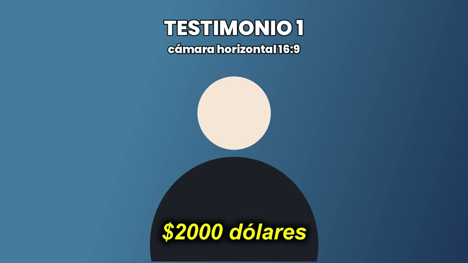 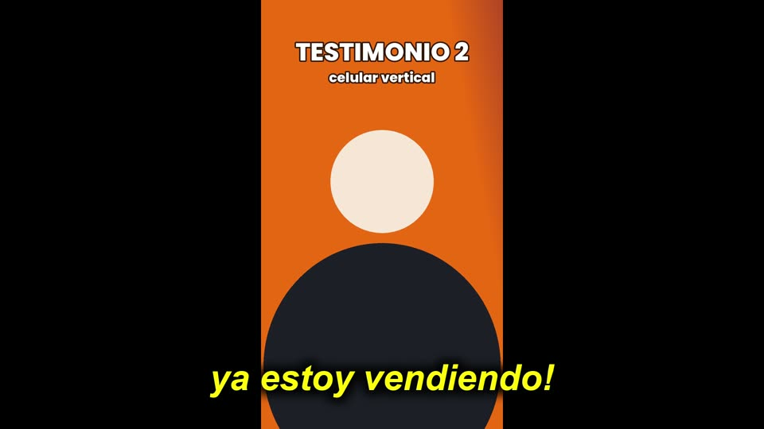 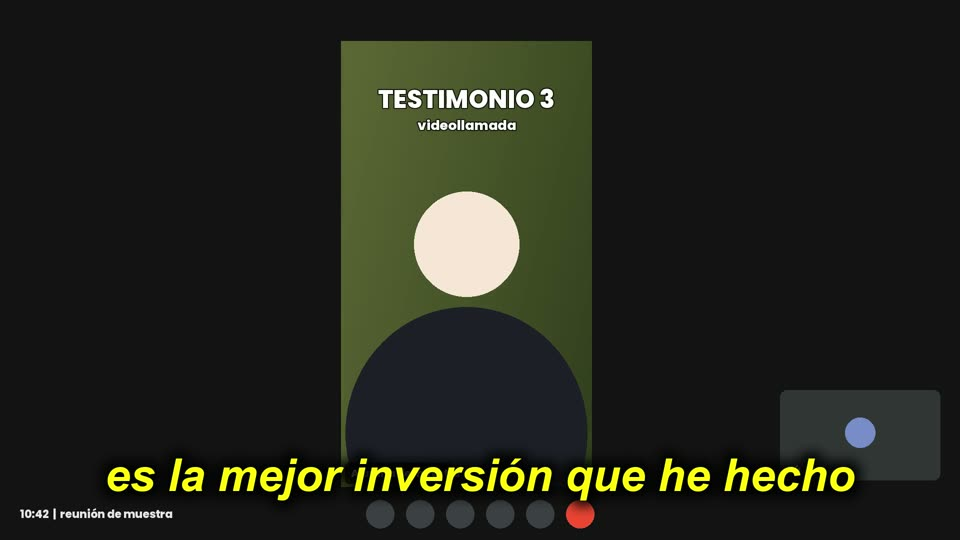 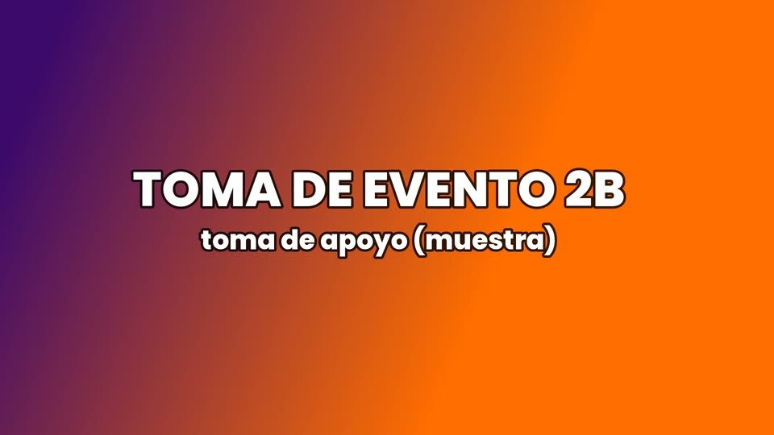 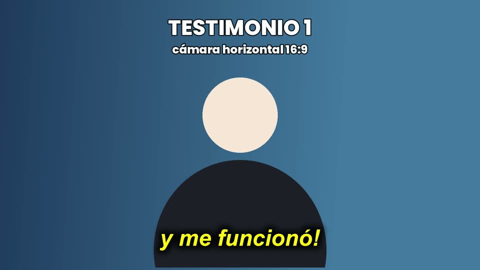 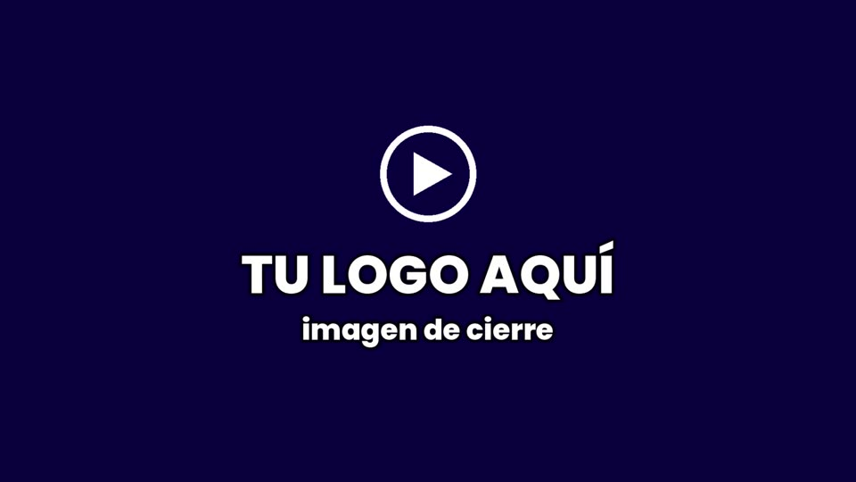 

**Para usarla, dile a Claude:** «Arma un compilado con la plantilla Testimonios usando los videos de esta carpeta: /ruta/a/mis-testimonios»

**Sirve para:** Compilado de resultados de alumnos o clientes; Video de prueba social para una página de venta; Resumen de un evento contado por sus asistentes; Juntar testimonios de fuentes muy distintas (videollamadas, celulares, notas de voz).

**Mejor usa otra si:** Un solo testimonio largo o una entrevista: usa editor-vsl; Video de venta con una persona a cámara: usa la plantilla Neón o Cinético; Casos sin tomas de evento ni otra imagen para cubrir las voces.

**Lo que necesitas tener:**
- Testimonios completos de 8 a 10 personas, de 1 a 3 minutos cada uno, en video o audio
- 5 minutos o más de videos de eventos reales, de 4 o más momentos distintos, con su sonido
- 1 grabación de pantalla compartida con la cifra de ingresos a la vista (10 a 15 s útiles)
- 1 grabación de pantalla del producto, de 30 s o más
- 2 a 4 capturas de resultados (opcionales)
- 1 logo con fondo transparente y, si hay, su cortinilla de sonido
- 1 canción con licencia
- Nombre de cada persona y su permiso para usar el testimonio

**Tiempo de edición:** 2 a 3 horas por cada 3 minutos de video, con los testimonios ya transcritos (estimado)

**Cómo se reparte el video:**

| Parte | % | Qué pasa |
|---|---|---|
| Gancho | 9 | 3 o 4 frases estrella, una por persona, cada una con su subtítulo amarillo y sin tomas de apoyo. |
| Puente | 2 | 3 tomas de evento con su propio sonido, sin voz. |
| Testimonios | 70 | Cadena de testimonios: la voz entra sobre tomas de evento, la persona da la cara y vuelven las tomas. |
| Prueba | 8 | Ráfaga de pantallas del producto y la pantalla compartida con la cifra de ingresos. |
| Remate | 8 | Racha de tomas de evento con la música arriba y una última frase corta. |
| Cierre | 3 | Corte seco al logo, fijo 6 segundos. |

**Archivos:** `plantillas/testimonios/ESTILO.md` (cómo se ve y cómo usarla), `ESCALETA-BASE.md` (estructura y guion para grabar), `base/` (proyecto en blanco).
Empezar un video: `scripts/nuevo.sh testimonios "Nombre del video" /ruta/al/video-cortado.mp4`

## Crear una plantilla nueva

A partir de un video o de una imagen que te guste, dile a Claude: «Crea una plantilla larga nueva a partir de este video: /ruta/al/video.mp4».
Claude lo estudia cuadro por cuadro en tu computadora (`scripts/desglosar.sh`), escribe la ficha, programa las animaciones y la agrega a este menú.
La plantilla queda guardada como texto y código: después ya no hace falta el video.

_Este archivo y `menu/index.html` los arma `scripts/menu.py` a partir de `plantillas/<id>/plantilla.json`. No los edites a mano._
